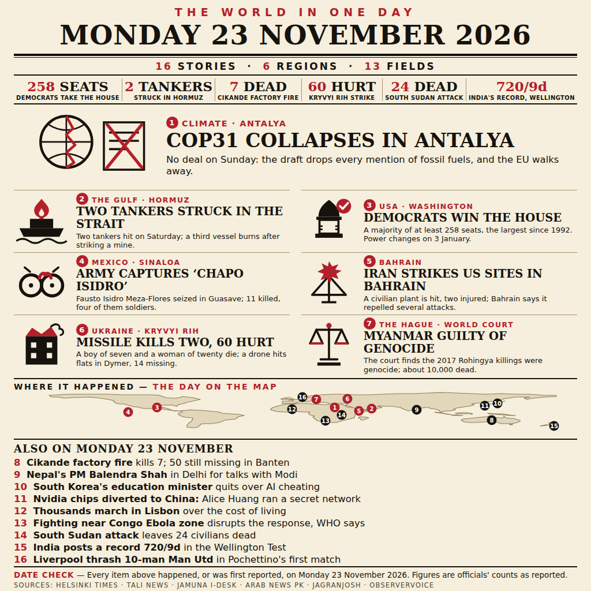

[](https://make.fun/bounty/news-image-20261123?utm_source=github&utm_medium=readme&utm_campaign=news-image-20261123)
[](https://make.fun/bounty/news-image-20261123/leaderboard?utm_source=github&utm_medium=readme&utm_campaign=news-image-20261123)
[](https://make.fun/bounty/news-image-20261123?utm_source=github&utm_medium=readme&utm_campaign=news-image-20261123)

# The World in One Day — 23 November 2026

An entry for make.fun's bounty **“Sum up 23 November's world news in one image”**, run under the
`program/v1` harness. The deliverable is a single 1024×1024 PNG: one printed front page that
carries the news of Monday 23 November 2026, dated in giant type on its face, and built to
stay readable when the page is scaled down to about 300 pixels across.



## The program

`main.ts` is Node 22, standard library only, and does one thing: it moves `entry.png` from the
repository root to `$MAKEFUN_OUTPUT_DIR/entry.png` (default `/output`), byte for byte, with no
decode and no re-encode. Two runs write identical bytes.

```sh
mkdir -p out && MAKEFUN_OUTPUT_DIR=out node main.ts
cmp entry.png out/entry.png && echo identical
```

The image is shipped in the repository rather than drawn at run time: the harness sandbox has
no network, and the rules say plainly that the simplest entry is a repository holding the image
and a one-line program that copies it there.

## What the page says

Sixteen stories, in three reading levels, so the page survives being shrunk:

1. **A stat strip** — the day in six numbers: 258 seats for the Democrats' new House majority,
   2 tankers struck in the Strait of Hormuz, 7 dead in the Cikande factory fire, 60 hurt in the
   Kryvyi Rih strike, 24 dead in the South Sudan attack, India's record 720/9d in Wellington.
2. **Seven pictured leads**, each with one bold drawn illustration, a region tag, one headline
   and one short caption — the COP31 collapse in Antalya as the lead, then the Hormuz tanker
   strikes, the Democrats' House win, the army's capture of 'Chapo Isidro' in Mexico, Iran's
   strikes on US sites in Bahrain, the Kryvyi Rih missile strike, and the world court's
   genocide ruling against Myanmar.
3. **A world locator map** — numbered dots place all sixteen stories, the page's focal point —
   and an **“Also on Monday 23 November”** rail of nine one-line briefs: the Cikande fire toll,
   Nepal's PM in Delhi, South Korea's education minister resigning over AI cheating, the Nvidia
   chip-diversion network, the Lisbon cost-of-living march, fighting near the Congo Ebola zone,
   the South Sudan attack, India's Wellington record, and Liverpool's win over Manchester United.

A date-check line closes the page: every item happened, or was first reported, on Monday
23 November 2026, with figures as officials reported them. Sources: Helsinki Times, TALi News,
Jamuna i-Desk, Arab News PK, JagranJosh, ObserverVoice.
